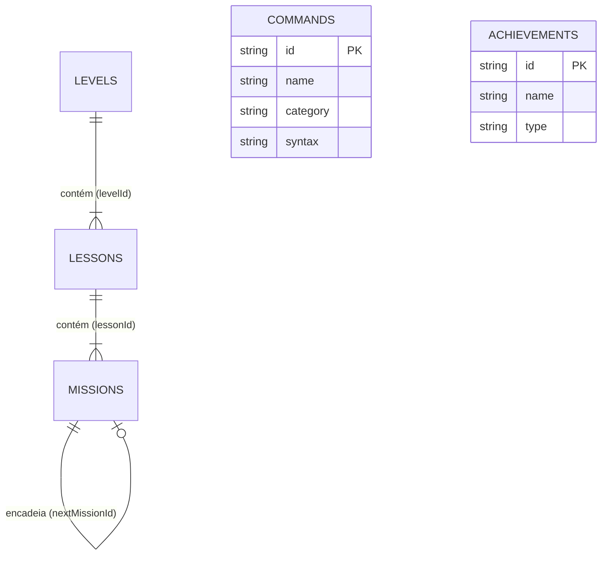
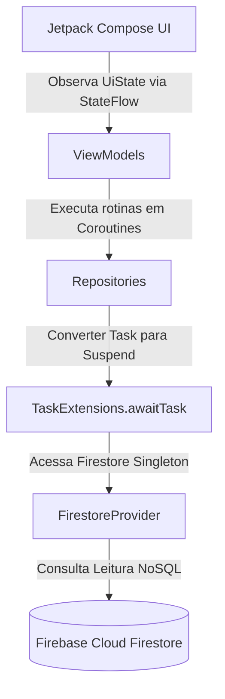
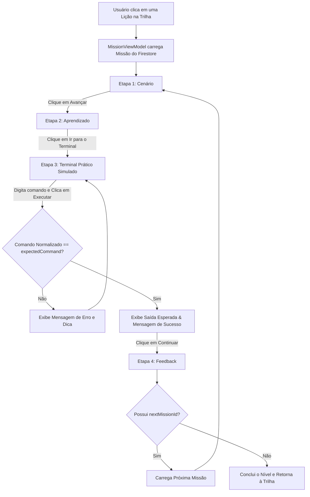

# 05. Diagramas — LinuxQuest

Diagramas explicativos em Mermaid representando o modelo de dados, arquitetura e fluxo de exercícios.

---

## 📊 1. Diagrama de Entidade-Relacionamento (ER)

---

## 🏛️ 2. Diagrama de Arquitetura do Sistema

---

## 🔄 3. Diagrama de Fluxo de uma Missão

